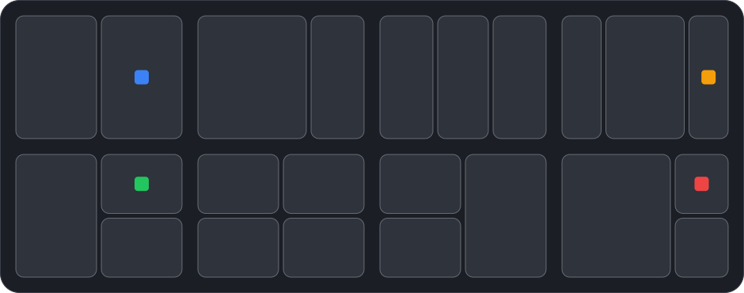

# Snap Layouts Hover

Windows 11 style **Snap Layouts** for KDE Plasma 6, triggered the way Windows
does it: rest the pointer on a window's caption buttons and pick a layout.

A KWin script. No dependencies, no daemon, no configuration files outside
KDE's own settings.



## What it does

- Rest the pointer for about 250 ms on the top-right caption strip of a window
  (its minimize/maximize/close buttons) and a flyout with eight layouts opens
  below them.
- Hover a zone to highlight it. Click it: that window goes there, then the
  remaining zones are filled with your other windows on the same screen
  (topmost first). Picking a layout always rearranges the zones, even when
  they overlap the previous arrangement.
- With "Only show it when another window is open" (default), the flyout stays
  away while there is nothing to arrange.
- Closes on click, on minimize/maximize/close, or when the pointer leaves
  neither stealing keyboard focus nor keeping the pointer.

## Layouts

| | | | |
|---|---|---|---|
| halves | 2/3 + 1/3 | thirds | wide middle (1/4 + 1/2 + 1/4) |
| left + right stacked | quarters | right + left stacked | main 2/3 + right stacked |

## Requirements

- KDE Plasma 6 (tested on 6.7.5, Wayland). X11 is untested.
- Nothing else. The flyout is plain QML in a KWin declarative script.

## Install

Download `snaplayoutshover-<version>.kwinscript` from Releases:

```bash
kpackagetool6 --type KWin/Script --install snaplayoutshover-1.0.0.kwinscript
```

Then open **System Settings > Window Management > KWin Scripts**, tick
**Snap Layouts Hover** and click **Apply**.

Building it yourself:

```bash
./tools/package.sh
kpackagetool6 --type KWin/Script --install dist/snaplayoutshover-1.0.0.kwinscript
```

## Settings

**System Settings > Window Management > KWin Scripts > Snap Layouts Hover > Configure**

| Option | Default | Meaning |
| --- | --- | --- |
| Show the flyout on hover | on | Master switch |
| Hotspot width | 72 px | Width of the trigger strip, from the window's right edge |
| Hotspot height | 0 | 0 = titlebar height |
| Hover delay | 250 ms | How long the pointer must rest |
| Fill the other zones with the other windows | on | Automatic fill after a click |
| Only show it when another window is open | on | Hide it with a single window |

## Known limits

- KWin does not expose decoration button rectangles, so the trigger is the
  top-right strip of the window frame, not the exact glyph. This also covers
  client-side decorated apps (Chromium, GTK), whose buttons KWin cannot see.
- Picking a layout with fewer zones than open windows leaves the extra windows
  where they are, possibly covered. Same as Windows 11.
- Zones are set as window geometry, so KDE's shared resize handle between
  quick-tiled windows does not apply.

## Development

```bash
./dev-reload.sh        # load the working copy into the running KWin
./dev-reload.sh hover  # same, and open the flyout once for a screenshot
```

Logs:

```bash
journalctl --user -f | grep snaplayoutshover
```

## License

MIT, see [LICENSE](LICENSE).
